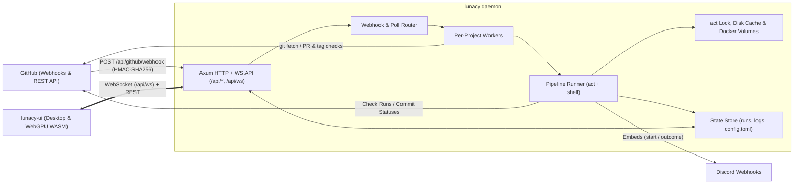

<div align="center">

<picture>
  <source media="(prefers-color-scheme: dark)" srcset="assets/logo-dark.svg">
  <source media="(prefers-color-scheme: light)" srcset="assets/logo-light.svg">
  
</picture>

<h1>Lunacy</h1>

<p><strong>Self-hosted local CI/CD daemon and real-time desktop/web UI built in Rust.</strong></p>

<p>
  <a href="https://www.rust-lang.org/"></a>
  <a href="#license"></a>
  
  <a href="https://github.com/teppyboy/lunacy/releases/tag/prerelease"></a>
</p>

<p>
  <a href="#features">Features</a> &middot;
  <a href="#architecture">Architecture</a> &middot;
  <a href="#quick-start">Quick Start</a> &middot;
  <a href="#configuration">Configuration</a> &middot;
  <a href="#platform--service-guides">Platform Guides</a> &middot;
  <a href="#desktop--web-ui">Desktop &amp; Web UI</a> &middot;
  <a href="#documentation">Documentation</a>
</p>

</div>

---

Lunacy watches your Git repositories via GitHub webhooks and/or polling, runs CI pipelines using [nektos/act](https://github.com/nektos/act) and shell commands, deploys on matching branches or tags, and reports live status back to GitHub and Discord. One daemon binary (`lunacy`), one strict TOML config file, pure-Rust TLS (`rustls`, no OpenSSL), and an optional native + WebGPU UI (`lunacy-ui`) that streams logs over WebSockets.

## Features

### Instant Triggers & Safe PR Builds
- **Webhooks + polling (`trigger_mode`):** Choose `"both"` (default), `"webhook"` (event-driven, `poll_interval = 0` allowed), or `"poll"` globally or per project. Incoming `POST /api/github/webhook` requests are HMAC-SHA256 verified (`X-Hub-Signature-256`) with delivery counters and last-delivery details exposed in the API and UI.
- **Fork-safe PR CI (`watch_prs`):** Automatically discovers and tests open pull requests on `opened`, `synchronize`, and `reopened` events or periodic polls. PRs always execute in isolated git worktrees and skip all deploy steps.
- **Branch & tag deploy gating (`deploy_refs`, `watch_tags`):** Restrict deploys to specific branch or tag globs such as `["master", "release/*", "tags/v*"]`, or leave empty to deploy only the project's default branch.

### Execution, Retries & Control
- **`act` + shell pipelines & configurable concurrency:** Mix GitHub Actions jobs (`kind = "act"`) and shell commands (`kind = "shell"`) across `ci` and `deploy` phases. Control parallelism with `general.max_concurrent_runs` (daemon-wide, default `1`, hot-reloads), `act.max_concurrent` (multi-slot `flock(2)` pool with per-slot action/BoltDB cache dirs and ephemeral `--artifact-server-port`), and `project.max_concurrent_runs` (`> 1` requires `checkout = "worktree"` or `"none"`, with per-project deploy serialization and suffixed project cache volumes).
- **Shared build handoff (`LUNACY_CI_DIR`):** The first `act` step clones the commit into a run-scoped checkout with `--bind`; every later step receives `LUNACY_CI_DIR` along with `LUNACY_SHA`, `LUNACY_BRANCH`, `LUNACY_REF`, `LUNACY_PROJECT`, `LUNACY_WORKDIR`, `LUNACY_RUN_ID`, and `LUNACY_PR_NUMBER`, so deploy steps can publish CI build outputs without re-running `act`.
- **Host OS filtering (`only_on`):** Restrict steps to `["linux"]`, `["windows"]`, or `["macos"]`. Steps excluded on the current host are recorded as `skipped` instead of failing CI, letting one config file serve multiple machines.
- **Timeouts, cancellation & recovery:** Configure step timeouts (`general.step_timeout`, `project.step_timeout`, `step.timeout`) and total pipeline deadlines (`project.timeout`). Active runs support full process-tree cancellation, and any run left in `running` state after a daemon crash is automatically reconciled to `cancelled` on startup.
- **Force deploy & one-click retries:** Trigger **Force deploy** for a project or a specific historical run (skipping CI unless an active deploy step references `LUNACY_CI_DIR`), re-run failed or finished pipelines from the UI (**Retry** / **Re-run**), or trigger **Retry CI**, **Retry Deploy**, and **Retry All** directly from native GitHub Check Run action buttons.

### Aggressive Build Caching
- **Enabled by default (`[act] cache = true`):** Persists `act`'s new action cache (`--use-new-action-cache`, `--action-cache-path`, `--action-offline-mode`) and local cache server (`--cache-server-path`) under `act.cache_dir` (default `<state_dir>/cache`).
- **Docker build volumes & BuildKit:** Mounts shared toolchain cache volumes (`cargo`, `rustup`, `pub`, `dart-server`, `npm`, `pnpm`, `go`, `pip`, `uv`, `ccache`) plus per-project volumes (`lunacy-cache-<slug>-cargo-target`, `lunacy-cache-<slug>-build`), sets `DOCKER_BUILDKIT=1` and `LUNACY_CACHE_DIR`, and appends `--pull=false` when mapped images already exist locally.
- **One-click cache cleanup:** Clear all caches (`POST /api/cache/clear`) or a single project's disk and Docker volume caches (`POST /api/projects/{name}/cache/clear`) from the API or Settings UI.

### GitHub & Per-Repo Discord Reporting
- **GitHub Check Runs & Commit Statuses:** Post rich GitHub App Check Runs (`mode = "checks"`, default contexts `lunacy/ci` and `lunacy/deploy`) with live substep tables, failure log tails, `details_url` deep links (`#/runs/{id}`), and retry action buttons — or classic commit statuses (`mode = "status"`) with a PAT.
- **Global & per-repo Discord webhooks:** Configure embeds globally under `[discord]` or override per project with `discord_enabled`, `discord_webhook_url` / `discord_webhook_url_file`, `notify_on_start`, `discord_notify_on` (`"all"` | `"failures"`), `discord_username`, and `discord_mention_on_failure` (mentions users/roles only, never `@everyone`). Includes an SSRF-safe test button (`POST /api/discord/test`) that only targets saved config URLs and never follows redirects.
- **Per-repo overrides & pausing:** Pause automatic polling and webhooks with `enabled = false` (manual triggers still work), toggle `github_enabled`, and override `contexts`, `shell`, `platforms`, `cache`, and `act_args` per project.

### Real-Time Desktop & Web UI (`lunacy-ui`)
- **Single Rune codebase, four targets:** Runs natively on Linux, macOS, and Windows (GUI subsystem with platform app icons) and compiles to a static WebGPU WASM bundle served directly by `lunacy` at `[server] web_root`.
- **WebSocket streaming with HTTP fallback:** Streams live project states, run updates, step logs, config reloads, and incoming webhook events over `GET /api/ws` (Axum + Tokio) and falls back cleanly to HTTP polling if needed.
- **Inspectable `act` logs & themes:** View `act` runs as expandable per-substep accordions (`Steps` | `Raw` toggle) with line-wrap (`Alt+Z`), switch between System, Light, Dark, and pure-black OLED themes, step discrete UI zoom (`90%`–`150%`), run offline pre-flight **Deploy Checks**, and edit `config.toml` live with comment preservation (`toml_edit`), masked secrets, and `*_file` secret support.
- **Persistent settings & desktop auto-updater:** Persists local UI settings across restarts on both desktop (`prefs.json`) and web (`localStorage`), and checks rolling GitHub `prerelease` archives with `SHA256SUMS.txt` verification and atomic binary swap on Linux and Windows.

## Architecture



## Quick Start

### Option 1: Download Pre-release Binaries

Rolling builds for **Linux (`x86_64`)**, **Windows (`x86_64`)**, and the **Web WASM bundle** are published to the [`prerelease`](https://github.com/teppyboy/lunacy/releases/tag/prerelease) release with `SHA256SUMS.txt`:

| Target | Archive | Contents |
| --- | --- | --- |
| Linux `x86_64` | `lunacy-linux-x86_64.tar.gz` | `lunacy`, `lunacy-ui`, `web/`, `config.example.toml`, `README.md`, `contrib/lunacy.service`, `contrib/lunacy.desktop`, `icons/` |
| Windows `x86_64` | `lunacy-windows-x86_64.zip` | `lunacy.exe`, `lunacy-ui.exe`, `web/`, `config.example.toml`, `README.md` |
| Web (`wasm32`) | `lunacy-web.tar.gz` | Static WebGPU UI files (`apps/lunacy-ui/dist/`) for `[server] web_root` |

> macOS pre-built archives are not published yet; build from source below.

### Option 2: Build from Source

```bash
# 1. Build the daemon binary -> target/release/lunacy (or install it: cargo install --path apps/lunacy --locked)
cargo build -p lunacy --release --locked
cargo test --workspace --locked

# 2. (Optional) Build the native desktop UI -> target/release/lunacy-ui
cargo build -p lunacy-ui --release --locked --bin lunacy-ui

# 3. (Optional) Build the static WebGPU WASM UI -> apps/lunacy-ui/dist/
./apps/lunacy-ui/build-web.sh
```

See [`apps/lunacy-ui/README.md`](apps/lunacy-ui/README.md) for Rune and `wasm-bindgen-cli` prerequisites.

### Configure & Run

Copy [`config.example.toml`](config.example.toml) to `config.toml` (git-ignored) and edit it for your repositories:

```bash
cp config.example.toml config.toml

# Validate syntax, strict keys, secret files, and print resolved project pipelines
lunacy check -c config.toml

# Run a single project pipeline once (uses latest upstream commit by default)
lunacy once -c config.toml my-app
lunacy once -c config.toml my-app --force
lunacy once -c config.toml my-app --sha <commit-sha> --force --reason "re-test release"

# Start the daemon (and HTTP/WebSocket API + Web UI when [server] is configured)
lunacy run -c config.toml
```

Pass `--log-level <trace|debug|info|warn|error|off>` to any subcommand to override `general.log_level`.

`lunacy` advances each project's last-processed SHA after a run finishes (pass or fail) so broken commits are not retried in an infinite poll loop; re-run manually with `lunacy once --force`, the UI **Retry** / **Run now** buttons, or GitHub's **Re-run** / **Retry CI** check actions.

## Configuration

Config validation is strict (`deny_unknown_fields`), so typos fail `lunacy check` and `PUT /api/config` instead of being silently ignored. Every secret can be placed inline or loaded from a separate file (`*_file`, trimmed on load, `~/` expanded, mutually exclusive with the inline key):

- `server.token` / `server.token_file`
- `github.token` / `github.token_file`
- `github.webhook_secret` / `github.webhook_secret_file`
- `github.app.private_key` / `github.app.private_key_path`
- `github.app.webhook_secret` / `github.app.webhook_secret_file`
- `discord.webhook_url` / `discord.webhook_url_file`
- `project.discord_webhook_url` / `project.discord_webhook_url_file`

The API masks inline secrets as `"********"` (echoing the mask on `PUT /api/config` preserves the stored secret) and never exposes secret file contents. Live edits preserve comments via `toml_edit`, write atomically with a `config.toml.bak` backup, and hot-reload idle project workers.

```toml
[general]
poll_interval = 300
trigger_mode = "both"          # both | webhook | poll
step_timeout = 3600            # default per-step timeout (seconds)
max_concurrent_runs = 1        # daemon-wide concurrent pipelines (hot-reloads)
log_level = "info"

[server]
listen = "127.0.0.1:7878"
token_file = "~/.config/lunacy/api-token"
web_root = "apps/lunacy-ui/dist"
public_url = "https://ci.example.com"

[github]
mode = "checks"                # checks (GitHub App) | status (PAT)
webhook_secret_file = "~/.config/lunacy/webhook-secret"

[github.app]
app_id = 123456
private_key_path = "~/.config/lunacy/github-app.pem"

[discord]
webhook_url_file = "~/.config/lunacy/discord-webhook"
notify_on_start = false
notify_on = "failures"         # all | failures
username = "lunacy"
mention_on_failure = "<@&1234567890>"

[act]
platforms = { "ubuntu-latest" = "catthehacker/ubuntu:act-latest" }
lock_file = "~/.local/state/act-gate.lock"
max_concurrent = 1             # defaults to general.max_concurrent_runs (hot-reloads)
cache = true                   # persists action cache, cache server & Docker volumes

[[project]]
name = "web-app"
repo_path = "/srv/repos/web-app"
remote = "origin"
branch = "main"
github_repo = "org/web-app"
checkout = "none"              # none | worktree | in-place
trigger_mode = "both"
watch_prs = true               # CI-only PR builds in isolated worktrees
deploy_refs = ["main", "tags/v*"]
watch_tags = true
timeout = 7200                 # total pipeline timeout (seconds)
max_concurrent_runs = 1        # > 1 requires checkout = "worktree" or "none" (deploys serialize)
discord_notify_on = "all"

[[project.ci]]
name = "Build & Test"
kind = "act"
workflow = ".github/workflows/ci.yml"
job = "build"
event = "push"
timeout = 3600

[[project.ci]]
name = "Windows Build"
kind = "act"
workflow = ".github/workflows/ci.yml"
job = "windows"
only_on = ["windows"]          # skipped on Linux/macOS without failing CI

[[project.deploy]]
name = "Publish"
kind = "shell"
run = """
rsync -a --delete "$LUNACY_CI_DIR/dist/" ./dist/
docker compose up -d --force-recreate web
"""
timeout = 900
```

See [`config.example.toml`](config.example.toml) for a complete, heavily annotated reference including self-CI and rolling pre-release configuration.

## Platform & Service Guides

<details>
<summary><strong>Linux (systemd service, desktop launcher &amp; icons)</strong></summary>

#### Run `lunacy` as a `systemd` user service

Copy [`contrib/lunacy.service`](contrib/lunacy.service) to `~/.config/systemd/user/lunacy.service`, adjust paths if needed, and enable it:

```bash
mkdir -p ~/.config/systemd/user
cp contrib/lunacy.service ~/.config/systemd/user/lunacy.service
systemctl --user daemon-reload
systemctl --user enable --now lunacy
journalctl --user -u lunacy -f

# Keep the user daemon running after logout
loginctl enable-linger "$USER"
```

If you use `act`, ensure your user is in the `docker` group so it can access the Docker socket.

#### Desktop entry & icons for `lunacy-ui`

Install [`contrib/lunacy.desktop`](contrib/lunacy.desktop) and the hicolor icon set:

```bash
install -Dm644 contrib/lunacy.desktop ~/.local/share/applications/lunacy.desktop

# From a release archive:
cp -r icons/hicolor/* ~/.local/share/icons/hicolor/

# Or directly from source:
install -Dm644 assets/icons/lunacy.svg ~/.local/share/icons/hicolor/scalable/apps/lunacy.svg
for sz in 16 32 48 64 128 256 512; do
  install -Dm644 "assets/icons/lunacy-${sz}.png" \
    "$HOME/.local/share/icons/hicolor/${sz}x${sz}/apps/lunacy.png"
done
```

</details>

<details>
<summary><strong>macOS (launchd agent &amp; Lunacy.app bundle)</strong></summary>

#### Run `lunacy` via `launchd`

Copy [`contrib/dev.lunacy.plist`](contrib/dev.lunacy.plist) to `~/Library/LaunchAgents/`, replace `/Users/REPLACE` with your home directory, and load it:

```bash
cp contrib/dev.lunacy.plist ~/Library/LaunchAgents/dev.lunacy.plist
# Edit paths in ~/Library/LaunchAgents/dev.lunacy.plist
launchctl load -w ~/Library/LaunchAgents/dev.lunacy.plist
tail -f ~/Library/Logs/lunacy.log
```

On macOS, `macos-latest`, `macos-14`, and `macos-15` default to `act`'s `-self-hosted` platform so macOS jobs run directly on the host. On Apple Silicon, pass `--container-architecture linux/amd64` in `[act] args` when an image or action requires amd64.

#### Assemble `Lunacy.app`

```bash
mkdir -p Lunacy.app/Contents/MacOS Lunacy.app/Contents/Resources
cp target/release/lunacy-ui Lunacy.app/Contents/MacOS/lunacy-ui
cp assets/icons/lunacy.icns Lunacy.app/Contents/Resources/lunacy.icns
cp contrib/macos/Info.plist Lunacy.app/Contents/Info.plist
```

</details>

<details>
<summary><strong>Windows (native host, WSL path translation, services &amp; UI)</strong></summary>

- **Self-hosted Windows jobs:** On Windows, `windows-latest`, `windows-2022`, and `windows-2025` automatically map to `-self-hosted` so jobs run natively on the host rather than inside a Linux container. Override per `[act]`, project, or step with `platforms`.
- **WSL mode & path translation:** If an `ubuntu-*` workflow hits `act` Windows path issues (`nektos/act#2645`), set `[act] command = ["wsl.exe", "-e", "act"]`. Lunacy rewrites `C:\...` paths to `/mnt/c/...` automatically, while self-hosted Windows jobs still invoke `[act] native_command` (default `["act"]`).
- **Host-specific steps & shells:** Use `only_on = ["windows"]` for Windows-only steps. Shell steps default to `["cmd", "/C"]` on Windows; override globally, per project, or per step with `shell = ["pwsh", "-NoProfile", "-Command"]` or Git Bash.
- **Artifacts:** Every `act` step receives `--artifact-server-path <state_dir>/artifacts/<run_id>` so `actions/upload-artifact@v4` works out of the box.
- **Desktop app & background service:** `lunacy-ui.exe` builds with `windows_subsystem = "windows"` and embedded multi-resolution icons (`assets/icons/lunacy.ico`). To run the daemon on boot, register it with Task Scheduler or Windows Services:

```powershell
sc.exe create lunacy binPath= "C:\path\to\lunacy.exe run -c C:\path\to\config.toml" start= auto
```

</details>

<details>
<summary><strong>GitHub App &amp; Webhook Setup</strong></summary>

Lunacy exposes `POST /api/github/webhook` whenever `[github] webhook_secret` (or `webhook_secret_file`) or `[github.app] webhook_secret` (or `webhook_secret_file`) is configured. No bearer token is required on this route; every payload is verified against `X-Hub-Signature-256`.

#### Standalone Repo Webhook (Commit Statuses or Trigger-Only)
1. In your repository, go to **Settings → Webhooks → Add webhook**.
2. Set **Payload URL** to `https://<your-host>/api/github/webhook` and **Content type** to `application/json`.
3. Generate a secret and save it to `[github] webhook_secret` or `webhook_secret_file`.
4. Subscribe to **Pushes** and **Pull requests** (for `watch_prs = true`).

#### GitHub App (Rich Check Runs + Retry Action Buttons)
1. Go to **GitHub → Settings → Developer settings → GitHub Apps → New GitHub App**.
2. Grant permissions:
   - **Checks:** Read & write
   - **Commit statuses:** Read & write
   - **Contents:** Read
   - **Metadata:** Read
   - **Pull requests:** Read (for `watch_prs` / PR triggers)
3. Subscribe to events: **`push`**, **`pull_request`**, **`check_run`**, and **`check_suite`**.
4. Set **Webhook URL** to `https://<your-host>/api/github/webhook` and put the same secret in `[github.app] webhook_secret` (or `webhook_secret_file`).
5. Generate a private key, save the `.pem` file, and set `app_id` and `private_key_path` under `[github.app]`. Install the App on your repositories (`installation_id` is auto-discovered if omitted).
6. Set `[server] public_url` so Check Run **Details** links open directly to `#/runs/{id}` in the web UI.

When a CI or deploy phase fails, times out, or is cancelled, Lunacy attaches native GitHub Check Run action buttons (**Retry CI** on CI checks; **Retry Deploy** and **Retry All** on deploy checks) that dispatch back to `POST /api/github/webhook`.

</details>

## Desktop & Web UI

`lunacy-ui` is a Rune client that compiles from a single view tree to native desktop binaries (Linux, macOS, Windows) and a static WebGPU WASM web app (`apps/lunacy-ui/dist/`).

- **Screens:** **Projects** overview (live status, PR indicators, paused badges, Run now / Cancel), **Project** detail (current run steps, trigger source & reason badges, Force deploy, open PRs, run history with Retry), **Run** detail (trigger source & reason header, expandable `Steps | Raw` `act` substep accordion, live streaming logs, Cancel / Retry / Force deploy, GitHub links), and **Settings** (live `config.toml` editor across General / Server / GitHub / Discord / act / Projects, offline pre-flight **Deploy Checks**, **Diagnostics**, **Connection**, and **Appearance**).
- **Themes & Zoom:** Neutral **System**, **Light**, **Dark**, and pure-black **OLED** themes plus discrete UI zoom stops (`90%`, `100%`, `110%`, `125%`, `150%`, or responsive auto).
- **Keyboard Shortcuts:**
  - `Cmd/Ctrl + S` — Save daemon config on config pages, or save & reconnect on **Settings → Connection** (`Enter` in Server URL / Token fields also saves & reconnects)
  - `Cmd/Ctrl + R` — Refresh and reconnect using the active connection
  - `Cmd/Ctrl + ,` — Open Settings
  - `Cmd/Ctrl + =` / `-` / `0` — Zoom in / out / reset
  - `Alt + Z` — Toggle log line wrap on the Run screen
  - `Esc` — Close open drawer/dialog, or navigate back
- **Local Settings Persistence:** Server URL, Bearer token, Theme, UI zoom, Log line wrap, `Steps | Raw` log mode, and desktop auto-update check preference are persisted across restarts in `prefs.json` on desktop (`~/.config/lunacy/prefs.json` with `0o600` permissions inside a `0o700` app directory on Linux/Unix, `~/Library/Application Support/lunacy/prefs.json` on macOS, `%APPDATA%\lunacy\prefs.json` on Windows; respects `RUNE_DIRS_ROOT` and `RUNE_PREFS_DIR`) and `localStorage` on web.
  - **Connection precedence:** `LUNACY_SERVER` / `LUNACY_TOKEN` env vars &gt; `--server` / `--token` CLI flags &gt; saved local settings &gt; defaults (`http://127.0.0.1:7878` on desktop, page origin on web).
- **Desktop Auto-Updater:** On Linux (`x86_64`) and Windows (`x86_64`), checks the rolling GitHub `prerelease` tag on startup (configurable in **Settings → Appearance**), verifies downloads against `SHA256SUMS.txt`, atomically swaps the binary, and prompts to relaunch.

See [`apps/lunacy-ui/README.md`](apps/lunacy-ui/README.md) for full UI build, mock server, screenshot, and E2E testing instructions.

## Project Layout

One Cargo workspace (`Cargo.toml`, one `Cargo.lock`): shared libraries in `crates/`, binaries in `apps/`.

```text
.
├── crates/
│   ├── lunacy-core/      The engine: config (schema, validation, masking), configfile
│   │                     (comment-preserving writes), git, exec (process trees, timeouts),
│   │                     act (invocation, --json parser, caching), pipeline (checkout, steps),
│   │                     model (runs, state, logs), report (GitHub checks/statuses),
│   │                     github_app (JWT), discord, deploy_check
│   └── lunacy-client/    The daemon's HTTP API for clients: wire types (model), the config
│                         document, one call per endpoint (api), transport (native ureq, wasm fetch)
├── apps/
│   ├── lunacy/           Daemon binary (`run`, `check`, `once`): worker loop (daemon.rs),
│   │                     Axum HTTP API + webhooks (api.rs), WebSocket hub (ws.rs); tests/
│   ├── lunacy-cli/       Command-line client for scripts and agents (docs/cli.md)
│   └── lunacy-ui/        Rune desktop + WebGPU web UI; tools/ has the mock server and e2e suite
├── assets/               Brand SVGs and platform icons (shared by daemon and UI builds)
├── contrib/              systemd unit, launchd plist, Linux `.desktop`, macOS `Info.plist`
├── docs/                 API contract, CLI guide, `act` notes
└── scripts/              CI scripts, icon generator, pre-release packager
```

The daemon and every client share `lunacy-client`'s types: `apps/lunacy/tests/api.rs` decodes each
daemon response with them and fails on any field a client would drop.

## Documentation

| Document | Description |
| --- | --- |
| [`docs/api.md`](docs/api.md) | Complete HTTP API v1 and WebSocket (`/api/ws`) protocol reference |
| [`docs/cli.md`](docs/cli.md) | `lunacy-cli` for scripts and agents: commands, JSON output, exit codes, recipes |
| [`docs/act.md`](docs/act.md) | How Lunacy drives `nektos/act`, `--json` parsing, locking, and OS notes |
| [`config.example.toml`](config.example.toml) | Annotated configuration reference with all global and per-project options |
| [`apps/lunacy-ui/README.md`](apps/lunacy-ui/README.md) | Building, developing, screenshotting, and testing `lunacy-ui` (desktop & web) |

## License

Licensed under the **MIT License** (see `[workspace.package]` in [`Cargo.toml`](Cargo.toml)).
